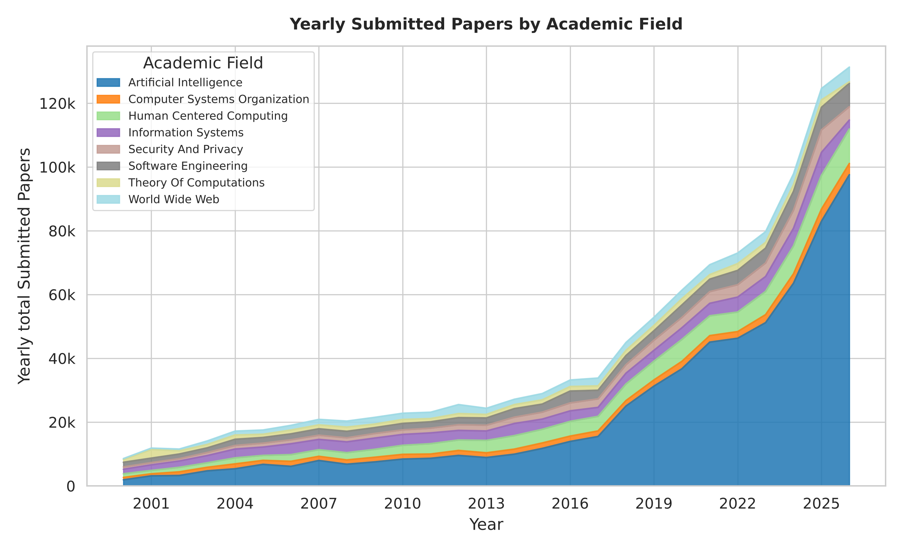
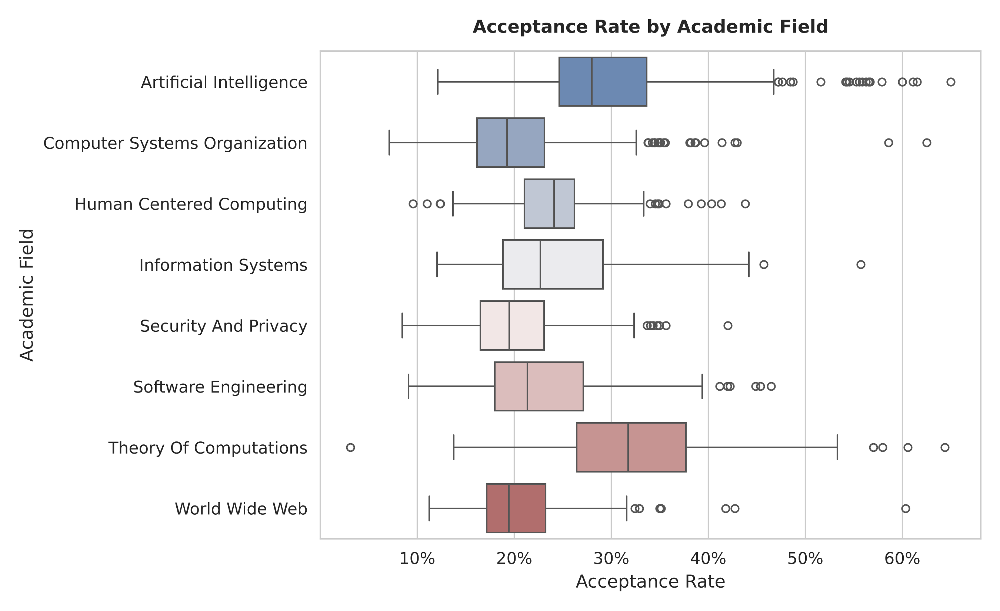
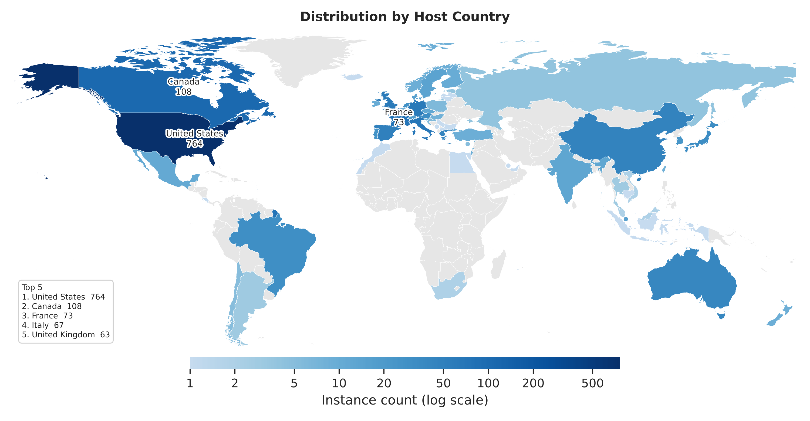
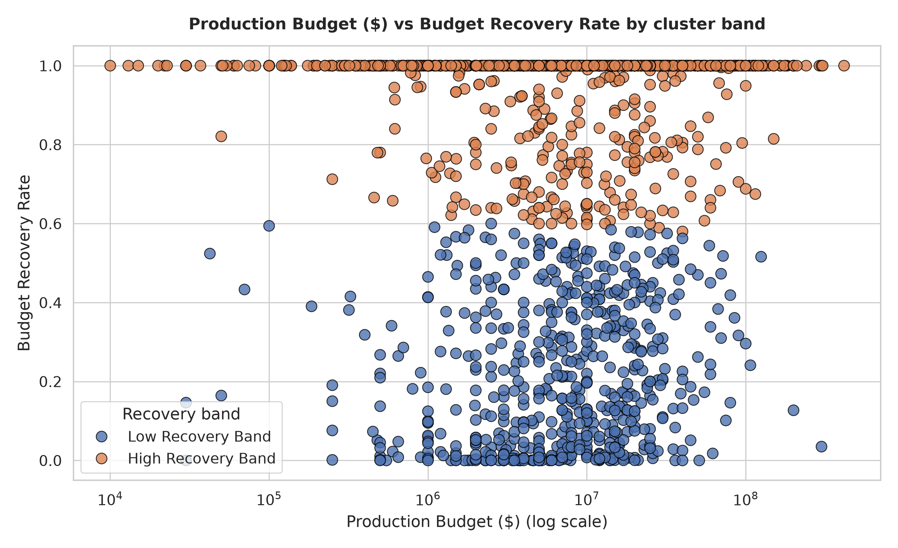
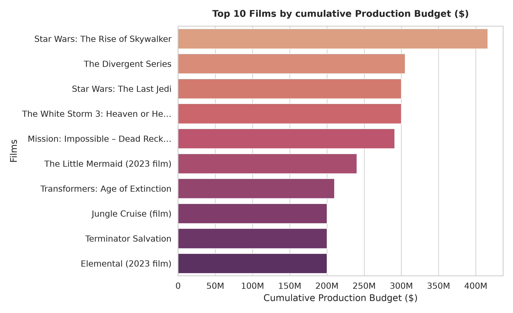
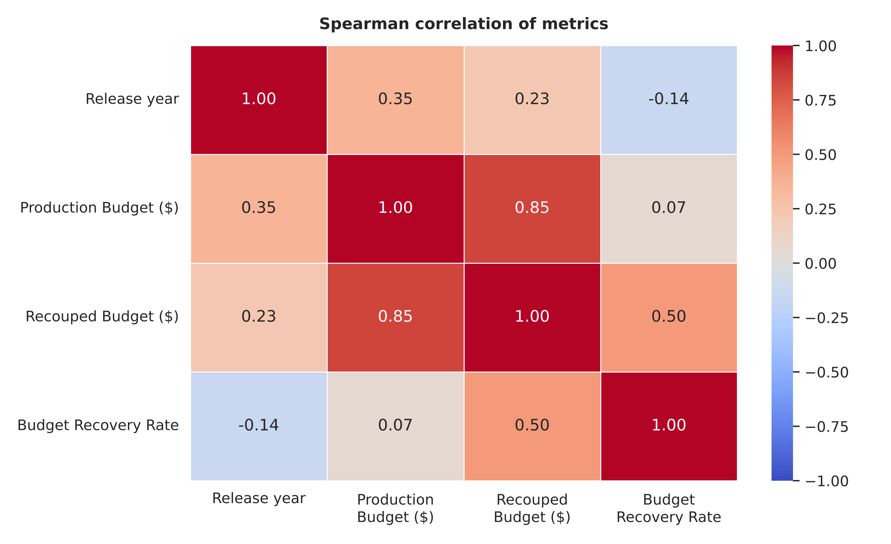
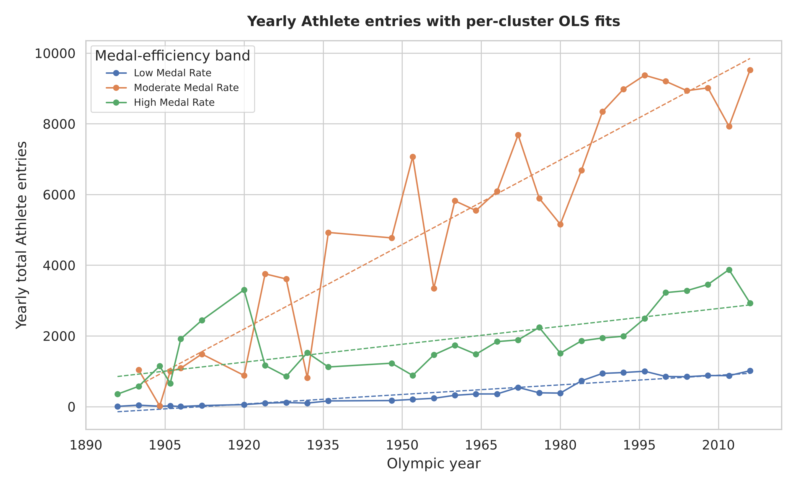
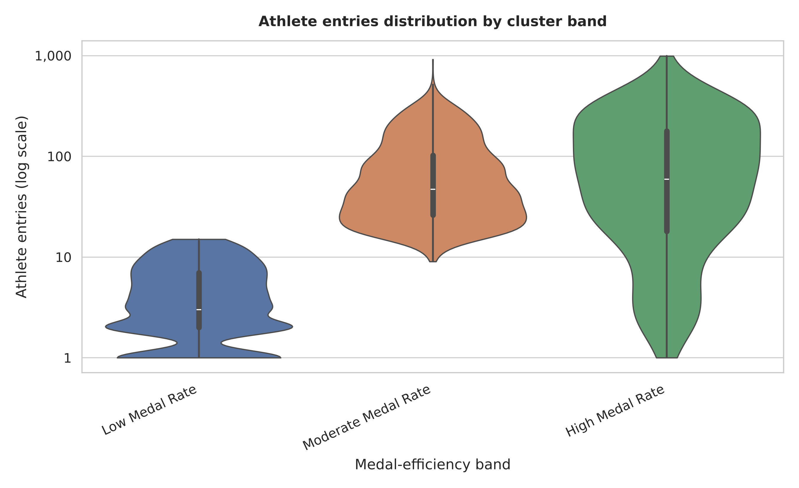

  [](https://github.com/saidfathalla/graphlens/actions/workflows/tests.yml) 

# GraphLens

**Machine learning-driven behavioural and visual analytics over heterogeneous knowledge graphs.**

GraphLens turns the result of a SPARQL query over any RDF knowledge graph into a complete, reproducible analysis: cleaned and recovered metrics, behavioural clusters, longitudinal trends, and a set of publication-ready figures whose chart types are chosen by an interpretable classifier. Nothing in the code is tied to a particular ontology. Everything domain-specific lives in a small YAML *profile* that maps SPARQL variables to analytical roles, so the same pipeline runs unchanged on scholarly events (EVENTSKG), films (DBpedia) and the Olympic Games: see [Use cases](#use-cases).

## How it works

| Module | What it does |
|---|---|
| **1. Ingestion & normalisation** | Parses a local or remote RDF file with `rdflib`, runs the SPARQL query, maps variables to roles via the profile, strips namespaces, parses years, and recovers missing values from the declared dependency *ratio = success / volume* (Open World Assumption: only values that are algebraically implied are filled). Every dropped row is logged with its reason, and a per-attribute Shannon-entropy profile flags near-constant, identifier-like and sparse predicates. |
| **2. Layout classification** | An entropy-criterion decision tree over column-name tokens and domain-neutral *shape descriptors* (temporal, geographic, bounded, skewed, cardinality, …) selects one of seven layouts per view: Line, Bar, Geomap, Scatter, Boxplot, Violin, Heatmap. It is trained on 566 labelled examples from six domains and validated with leave-one-domain-out cross-validation. The fitted tree is exported as a human-readable IF-THEN rule base. |
| **3. Analytics** | K-means on (log-)volume and ratio with K swept over {2,…,6} and selected by silhouette, reported with Davies-Bouldin, WCSS and bootstrap ARI stability. OLS trend models with HAC (Newey-West) standard errors, log-linear growth rates and Durbin-Watson diagnostics, globally and per cluster. |
| **4. Rendering & reporting** | Renders each view with its routed layout (300 dpi PNG; Geomap is a choropleth world map), and writes a JSON run report, a routing report with classifier confidence and low-confidence flags, and all intermediate tables. |

## Use cases

The same code runs on three unrelated knowledge graphs; only the SPARQL query and the profile change. **[docs/USE_CASES.md](docs/USE_CASES.md) gives the offline and live commands for each case.** Every run produces eight figures; the examples below show each chart type once, taken from whichever use case shows it best.

| Chart type | Shown for |
|---|---|
| Stacked area (the Line layout split by category), choropleth map, box plot | Scholarly events |
| Scatter, bar, heatmap | Films |
| Line with trend fits, violin | Olympic Games |

### 1. Scholarly events (EVENTSKG)

Submissions and acceptance rates of top computer-science conferences, 2000-2026, by research field and host country. The field chart shows the surge in artificial-intelligence submissions after 2017; the three bands separate highly competitive, moderate and accessible venues.

<p>


</p>


### 2. Films (DBpedia)

Film budgets and box-office recovery by original language and country, queried live from the DBpedia SPARQL endpoint (a reproducible hash sample of 3 of 16 slices: 1,963 films with a US-dollar budget and gross, 1950-2025). The two bands separate films that earned back their budget (1,374; median recovery 100%) from those that did not (589; median 18%).

<p>


</p>


### 3. Olympic Games (Olympics KG)

National delegations at the Summer Olympics, 1896-2016 (1.78 million triples, 229 NOCs). Women's share of athlete entries rises from 1.6% in 1900 to 45.7% in 2016; the dips in 1932, 1956 and 1980 are the Depression and the boycotts. Delegations fall into three medal-efficiency bands.

<p>


</p>

## Installation

Python 3.10 or newer.

```bash
pip install -r requirements.txt
```

The repository includes `data/training_data.csv` (layout training corpus) and `data/world_countries.geojson` (Natural Earth country outlines, public domain). Keep both in `data/`.

## Quick start

The commands for all three use cases, offline and live, are in [docs/USE_CASES.md](docs/USE_CASES.md). In short:

```bash
# EVENTSKG (scholarly events)
python3 graphlens.py -q queries/eventskg-query.rq -f data/eventskg.ttl \
    -p profiles/eventskg-profile.yaml -o output/eventskg

# DBpedia (films), local copy of the sample
python3 graphlens.py -q queries/dbpedia-query.rq -f data/dbpedia_films.nt \
    -p profiles/dbpedia-profile.yaml -o output/dbpedia

# Remote RDF file instead of a local one
python3 graphlens.py -q queries/eventskg-query.rq -p profiles/eventskg-profile.yaml \
    -u https://raw.githubusercontent.com/saidfathalla/EVENTSKG-Dataset/master/EVENTSKG.ttl

# Live SPARQL endpoint: the query runs remotely and results are fetched page by page
python3 graphlens.py -q queries/dbpedia-query.rq -p profiles/dbpedia-profile.yaml \
    -e https://dbpedia.org/sparql -o output/dbpedia-live --page-size 10000 --max-rows 2000
```

With `-f` or `-u` the whole graph is parsed into memory. With `-e` only the query result is transferred, so graph size is limited by the endpoint, not by your machine. GraphLens pages with `LIMIT`/`OFFSET`, keeps requesting until an empty page comes back (so per-request row caps such as DBpedia's are handled), retries on HTTP 429/5xx, dropped connections and responses cut off mid-transfer (with back-off; if a large page keeps failing, the page size is halved automatically, down to 250 rows), and types values exactly as in file mode, so both modes give identical results for the same data. If your query already ends with `LIMIT` or `OFFSET`, it is sent once, unpaged. After paging, GraphLens asks the endpoint for a `COUNT` of the same query and warns if rows are missing, for example because DBpedia (Virtuoso) cannot page deep into results sorted with `ORDER BY`; it also warns when the endpoint marks a response as partial (query time limit) or when rows repeat across pages. Avoid `ORDER BY` in queries meant for public endpoints. A page that the endpoint marks as partial (time limit hit) is retried, never taken as the end of the data.

**Heavy queries on public endpoints.** A query that aggregates (`GROUP BY`) is re-run in full for every page, which can exceed an endpoint's time limit. Put the line `# GRAPHLENS-PARTITION ?var` inside its `WHERE` clause, where `?var` is the entity variable (e.g. `?film`). In endpoint mode GraphLens then runs the query as 16 independent slices, each restricted with `FILTER(SUBSTR(MD5(STR(?var)), 1, 1) = "0"…"f")`, pages and verifies each slice, and joins them; use `--partitions 256` for very large results. With `--max-rows`, whole slices are fetched until the limit is reached, which gives a reproducible random sample. Place the line in a small sub-query that selects the entities (see `queries/dbpedia-query.rq`): Virtuoso ignores the filter inside a large aggregated block. In file mode the line is an ordinary comment. `queries/dbpedia-query.rq` uses this. Rows are put into a fixed order before analysis, so results do not depend on the order in which a file or endpoint returned them.

### Command-line options

| Option | Default | Meaning |
|---|---|---|
| `-q, --query` | required | SPARQL file or https URL |
| `-p, --profile` | required | Profile YAML file or https URL |
| `-f, --file` / `-u, --url` / `-e, --endpoint` | one required | Local RDF file, remote RDF file (format detected from extension or content type), or SPARQL endpoint URL |
| `-t, --training` | `data/training_data.csv` | Layout training corpus. If missing, a 7-row fallback is used and a warning is logged; results then do not generalise |
| `-o, --output` | `output` | Output folder |
| `--seed` | `42` | Seed for every stochastic step (K-means, bootstrap, classifier) |
| `--stability-runs` | `50` | Bootstrap runs for cluster stability (overrides the profile) |
| `--log-level` | `INFO` | `DEBUG`, `INFO`, `WARNING`, `ERROR` |
| `--page-size` | `5000` | Endpoint mode: rows requested per page |
| `--max-rows` | none | Endpoint mode: stop after this many rows. With a `GRAPHLENS-PARTITION` query, whole slices are fetched, giving a reproducible random sample |
| `--timeout` | `120` | Endpoint mode: seconds per request |
| `--stable-order` | off | Endpoint mode: wrap the query with `ORDER BY` over all variables so pages are deterministic. Slower; use it when the endpoint may change row order between requests |
| `--no-count-check` | off | Endpoint mode: skip the `COUNT` query that verifies every row arrived |
| `--partitions` | `16` | Endpoint mode: number of slices (1, 16 or 256) for queries containing `# GRAPHLENS-PARTITION ?var` |

## Writing a profile

A profile tells GraphLens which SPARQL variable plays which analytical role. Minimal example:

```yaml
target_class: Conference
labels: {volume: Submitted papers, rate: Acceptance rate, category: Research field,
         location: Country, entity_group: Event series}
attributes:
  independent_metrics:          # first = volume (x1), second = success count (x2)
    - {identifier: submitted, sparql_var: submittedPapers}
    - {identifier: accepted,  sparql_var: acceptedPapers}
  derived_ratios:               # y = x2 / x1
    - {identifier: acceptanceRate, sparql_var: acceptanceRate}
  nominal_categories:
    - {identifier: field,   sparql_var: field}
    - {identifier: country, sparql_var: country, semantic_type: geo}
  temporal_indicators:
    - {identifier: date, sparql_var: startDate}
  entity_identifiers:
    - {identifier: acronym, sparql_var: acronym}
```

Optional sections (defaults shown):

```yaml
filters:       {year_min: null, year_max: null}
clustering:    {log_volume: true, k_min: 2, k_max: 6, fixed_k: null, stability_runs: 50}
cluster_bands: [Low-ratio band, Moderate-ratio band, High-ratio band]
analysis:      {corr_method: spearman, geomap: map, geo_shapes: data/world_countries.geojson,
                top_n: 10, top_categories: 10, low_confidence: 0.5}
# top_categories: charts show the most frequent categories and group the rest as "Other"
# (display only; clustering and trends use all values). Long labels are shortened in charts.
labels:        {time: Year, count: Instance count, band: Cluster band}   # plus volume, success, rate, …
value_aliases: {country: {USA: United States}}
normalization:
  ratio_scale: auto        # auto (values > 1 are percentages) | fraction | percent | unbounded
  year_pattern: '(?<!\d)(\d{4})(?!\d)'
  time_fallback: [date, year]
  entity_fallback: [label, name, title, acronym]
```

`sparql_var` may be a list when different queries name the same attribute differently. Use `ratio_scale: unbounded` for ratios that can exceed 1 (e.g. growth factors); this also disables the *success ≤ volume* consistency check. Set `analysis.geomap: bar` to draw the geographic view as a ranked bar chart instead of a map. All axis and legend wording comes from `labels`, so figures can be produced in any domain vocabulary or language.

## Outputs

| File | Content |
|---|---|
| `fig1_cluster_scatter.png` … `fig8_cluster_density.png` | One figure per analytical view, rendered with the routed layout |
| `features_matrix.csv` | Normalised table with recovery flags and cluster assignments |
| `normalization_dropped.csv` | Every dropped row with its reason |
| `attribute_entropy.csv` | Shannon entropy (bits and normalised), distinct values, missing rate and flags per attribute |
| `cluster_validation.csv`, `cluster_summary.csv` | K sweep metrics (silhouette, Davies-Bouldin, WCSS, ARI) and per-band statistics |
| `yearly_aggregates.csv` | Yearly totals used for the trend models |
| `routing_report.csv` | Per view: shape descriptors, predicted layout, confidence, rendered layout, fallback status |
| `layout_rules.txt` | The classifier as IF-THEN rules with support and confidence |
| `run_report.json` | All of the above summarised, plus trend models, module timings and, in endpoint mode, paging statistics (`ingest`) |

## Reproducing the evaluation

Run from the repository root. Each experiment writes CSV files to its output folder (`layout_baselines.py` and `recovery_masking.py` also print a LaTeX table with `--latex`).

```bash
# Layout classifier: baselines, feature ablation, per-domain accuracy, McNemar tests
python3 experiments/layout_baselines.py -t data/training_data.csv -o results/layout

# Regenerate the (synthetic, rule-based) classifier training corpus data/training_data.csv
python3 experiments/make_training_data.py

# Missing-value recovery: MCAR masking at 10-50% vs mean, median, k-NN and MICE
python3 experiments/recovery_masking.py -q queries/eventskg-query.rq -f data/eventskg.ttl \
    -p profiles/eventskg-profile.yaml -o results/recovery

# Clustering baselines (GMM, Ward), initialisation and bootstrap stability, OLS diagnostics
python3 experiments/evaluate_robustness.py -q queries/eventskg-query.rq -f data/eventskg.ttl \
    -p profiles/eventskg-profile.yaml -o results/robustness

# Analytical correctness: 12 hand-computed cases (see experiments/correctness/README.md)
python3 graphlens.py -f experiments/correctness/analytical_correctness.ttl \
    -q experiments/correctness/analytical_correctness.rq -p experiments/correctness/profile.yaml \
    -o experiments/correctness/output
python3 experiments/correctness/validate_results.py

# Scalability: enlarge EVENTSKG, then one warm-up + 5 timed runs (needs GNU /usr/bin/time)
python3 experiments/scalability/scale_rdf.py --input data/eventskg.ttl \
    --output experiments/scalability/EVENTSKG_500k.ttl --target-triples 500000 \
    --target-class "https://w3id.org/scholarlydata/ontology/conference-ontology.owl#Conference"
bash experiments/scalability/benchmark.sh graphlens.py experiments/scalability/EVENTSKG_500k.ttl \
    queries/eventskg-query.rq profiles/eventskg-profile.yaml experiments/scalability/results_500k 5
```

Timings depend on hardware; the timings in `experiments/scalability/results_*_timings.csv` were measured on an Intel Core Ultra 5 225U with 30 GB RAM.

## Repository layout

```
graphlens.py            the tool (single file)
queries/  profiles/     SPARQL query and YAML profile for each use case
                        (queries/dbpedia-snapshot.rq makes the local DBpedia copy)
data/                   training_data.csv, world_countries.geojson, eventskg.ttl, dbpedia_films.nt
docs/                   USE_CASES.md (how to run each case) and the figures shown above
experiments/            evaluation scripts; correctness/ and scalability/ experiments
tests/                  pytest suite (run on every push)
```

Generated and large files are not tracked (see `.gitignore`): run outputs in `output/` and `results/`, the Olympics data (`data/olympics.ttl`, `olympics_db/`) and the enlarged scalability graphs.

## Tests

```bash
pip install pytest
python3 -m pytest
```

The suite covers entropy (Eq. 1), missing-value recovery and consistency checks, year parsing, ratio scales, the dropped-row audit, series naming and spelling, country matching and aliases, rule export, the `fixed_k` guard, seed reproducibility, category folding and label display, SPARQL endpoint paging/retries/row caps, slicing and sampling (against a local test server, no network needed) and end-to-end runs, including file mode versus endpoint mode giving identical results. It runs on every push via GitHub Actions (Python 3.10–3.12).

## Citation

If you use GraphLens, please cite:

> Fathalla, S. and Mohamed, H. (2026). GraphLens: Machine learning-driven behavioural and visual analytics over heterogeneous knowledge graphs. Submitted to *Knowledge-Based Systems*.

See also [`CITATION.cff`](CITATION.cff).

## License

Code: MIT. `data/world_countries.geojson` is derived from [Natural Earth](https://www.naturalearthdata.com/) 1:50m Admin 0 – Countries (public domain).
