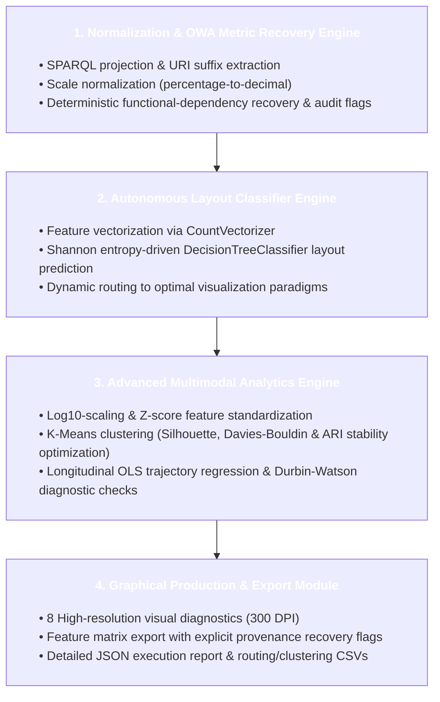

# GraphLens: Automated Schema-Agnostic Semantic Graph Analytics Framework

**GraphLens** is an automated, profile-configurable command-line framework engineered to bridge the gap between uncurated RDF Knowledge Graphs (KGs) and advanced statistical, longitudinal, and machine learning analytics.

Rather than requiring custom data engineering scripts, manual schema mappings, or complex SPARQL query overhauls, GraphLens decouples analytical execution logic from domain ontologies using declarative YAML configuration profiles. Operating under Open-World Semantics (OWA), GraphLens handles missing data recovery, entropy-driven layout routing, unsupervised $K$-means behavioral clustering, and Ordinary Least Squares (OLS) longitudinal modeling in a single execution pipeline.

---

## Architecture & Four-Module Pipeline

GraphLens operates via four modular processing stages:



## Features

* **Declarative Schema Agnosticism**: Fully decouples execution logic from specific SPARQL endpoints or ontology prefixes via external SPARQL query files (`.rq`) and lightweight YAML configuration profiles (`profile.yaml`).
* **Deterministic OWA Metric Recovery**: Reconstructs missing attributes (e.g., deriving `acceptanceRate` or `acceptedPapers` count) using exact functional dependencies defined in the YAML profile under Open-World Assumption (OWA) principles. All derived records are tagged with audit provenance flags (`y_recovered`, `x2_recovered`, `y_rescaled`, `inconsistent`).
* **Entropy-Driven Layout Classifier**: Bootstraps an entropy decision tree classifier (`DecisionTreeClassifier` on `CountVectorizer` tokens + dataset structural shape descriptors) to dynamically map dataset features to 7 layout paradigms (`Line`, `Bar`, `Geomap`, `Scatter`, `Boxplot`, `Violin`, `Heatmap`).
* **Unsupervised $K$-Means Behavioral Profiling**: Performs $\log_{10}$-transformed and Z-score standardized $K$-means clustering across continuous selectivity boundaries to group entities into human-readable, domain-configured taxonomy bands (e.g., *Low-ratio*, *Moderate-ratio*, *High-ratio*).
* **Longitudinal Trajectory Modeling**: Embeds Ordinary Least Squares (OLS) linear regressions with Durbin-Watson residual independence checks to measure multi-decadal growth slopes, log-linear annual growth rates, and goodness-of-fit ($R^2$).
* **Dual Production Output Suite**: Exports a complete machine-learning-ready data matrix (`features_matrix.csv`) alongside a comprehensive suite of 8 publication-ready visual diagnostics.

---

## Installation

### Prerequisites

* Python 3.8+ (Python 3.12 recommended)
* `pip` package manager

### Installation Steps

1. Clone the repository:
   ```bash
   git clone https://github.com/saidfathalla/graphlens.git
   cd graphlens
   ```

2. Create and activate a virtual environment (recommended):
   ```bash
   python3 -m venv venv
   source venv/bin/activate  # On Windows: venv\Scripts\activate
   ```

3. Install requirements:
   ```bash
   pip install -r requirements.txt --upgrade
   ```

---

## Usage

GraphLens is executed via a CLI interface accepting SPARQL queries, configuration profiles, and RDF input sources (file path or remote URL).

### Command-Line Arguments

| Argument | Long Flag | Description | Required |
|---|---|---|---|
| `-q` | `--query` | Path or URL to the SPARQL query file (`.rq`) | Yes |
| `-p` | `--profile` | Path or URL to the YAML profile file (`.yaml`) | Yes |
| `-u` | `--url` | Direct HTTPS URL to remote RDF Turtle dataset | Mutually exclusive |
| `-f` | `--file` | Local file path to RDF Turtle dataset | Mutually exclusive |
| `-t` | `--training` | Path to layout classifier training dataset (Default: `data/training_data.csv`) | No |
| `-o` | `--output` | Output directory (Default: `output`) | No |
| `--seed` | `--seed` | Random seed for $K$-means & layout classifier (Default: `42`) | No |
| `--log-level` | `--log-level` | Logging verbosity (`DEBUG`, `INFO`, `WARNING`, `ERROR`) | No |

### Examples

**1. Execution using Remote EVENTSKG Dataset (URL):**

```bash
python3 graphlens.py \
  --query eventkg_query.rq \
  --profile profile.yaml \
  --url https://raw.githubusercontent.com/saidfathalla/EVENTSKG-Dataset/master/EVENTSKG.ttl
```

**2. Execution using Local RDF File:**

```bash
python3 graphlens.py \
  --query query.rq \
  --profile profile.yaml \
  --file dataset.ttl \
  --output output_dir
```

---

## Output Artifacts

Upon completion, GraphLens writes structured analytical reports, CSV data matrices, and visual assets directly to the configured output directory (`output/` by default).

### 1. Data & Analytics Artifacts

* 📊 **`features_matrix.csv`**: Provenance-augmented feature space containing normalized data, cluster band labels, and explicit recovery flags (`y_recovered`, `x2_recovered`, `y_rescaled`, `inconsistent`).
* 📋 **`cluster_summary.csv`**: Grouped cluster medians, quartile distributions (P25, P75), and mean ratios across identified taxonomy bands.
* 📈 **`yearly_aggregates.csv`**: Annual aggregations tracking total volume, mean metrics, and entity instance counts over time.
* 🔬 **`cluster_validation.csv`**: $K$-means sweep evaluation metrics (Silhouette score, Davies-Bouldin index, WCSS, and Adjusted Rand Index stability scores).
* 📑 **`routing_report.csv`**: Layout classification predictions, model confidence scores, rendered layouts, and expert layout agreement flags.
* 📄 **`run_report.json`**: Complete execution metadata including pipeline module execution timings (seconds), input triple counts, OWA recovery counts, and OLS regression slopes/p-values.

### 2. Publication-Ready Visual Diagnostic Suite

| Asset File | Layout Paradigm | Description |
|---|---|---|
| `fig1_cluster_scatter.png` | Scatter Plot | Maps primary volume metrics against derived ratios, segmented by cluster bands. |
| `fig2_cluster_trend_ols.png` | Line Plot | Traces multi-decadal yearly total metrics overlaid with per-cluster OLS regression fit lines. |
| `fig3_field_growth.png` | Stacked Area / Line | Displays temporal macro-scale growth distributions across research domains or categories over time. |
| `fig4_geo_distribution.png` | Geomap / Bar Chart | Illustrates geographic distribution and instance densities across host locations/countries. |
| `fig5_correlation.png` | Correlation Heatmap | Computes Spearman or Pearson rank correlation matrices across key numerical metrics. |
| `fig6_ratio_by_category.png` | Boxplot | Illustrates cross-domain ratio variance, inner quartiles, medians, and outlier boundaries. |
| `fig7_top_entities.png` | Horizontal Bar Chart | Ranks the top 10 most active entities/series by cumulative primary metric volume. |
| `fig8_cluster_density.png` | Violin Plot | Log-scaled probability density violin profiles exposing boundary cutoffs between cluster bands. |

---

## Testing & Quality Assurance

GraphLens includes a test suite powered by `pytest` that verifies data transformations, regular expression parsing, OWA recovery logic, and pipeline execution.

### Run Tests Locally

To execute the test suite:

```bash
python3 -m pytest
```

### Continuous Integration (CI)

A GitHub Actions workflow is pre-configured to execute `pytest` across Python versions on every `push` or `pull_request` to ensure deterministic calculations, numeric coercion accuracy, and pipeline stability.

---

## Citation

If you use GraphLens in your research, please cite our paper:

```bibtex
@article{fathalla2026graphlens,
  title     = {From Triples to Insights: A Schema-Agnostic Framework for Automated Knowledge Graph Visual Analytics},
  author    = {Fathalla, Said},
  journal   = {Submitted to Journal of Intelligent Information Systems},
  year      = {2026},
  publisher = {Springer}
}
```

---

## License

Distributed under the MIT License. See `LICENSE` for more information.
